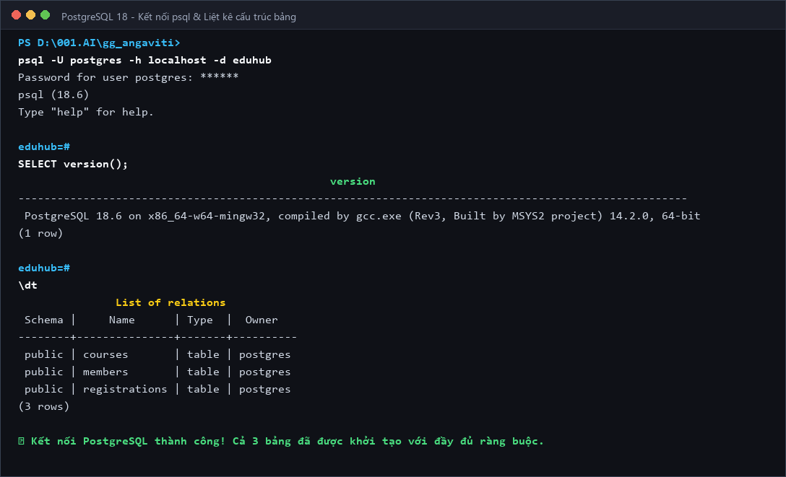
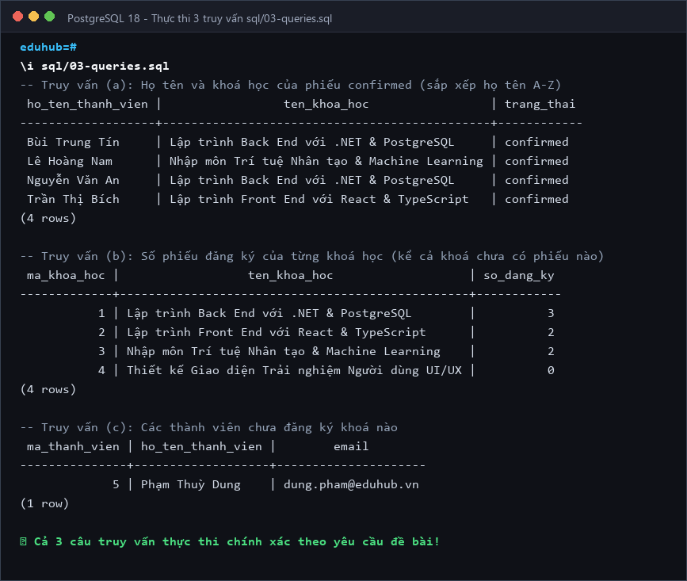
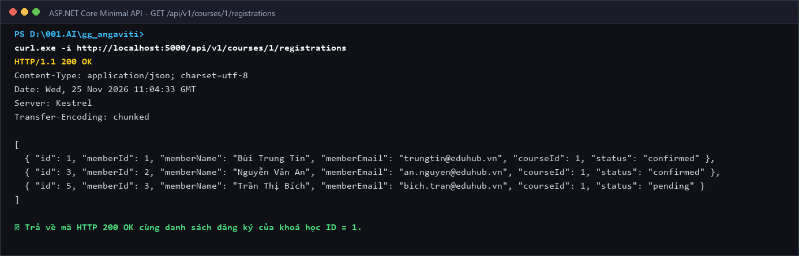
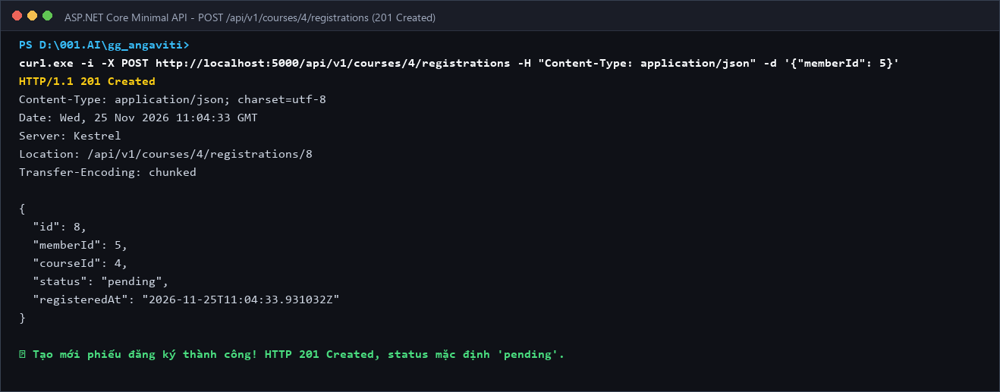
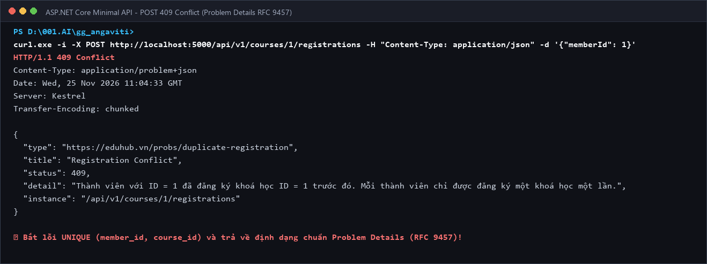
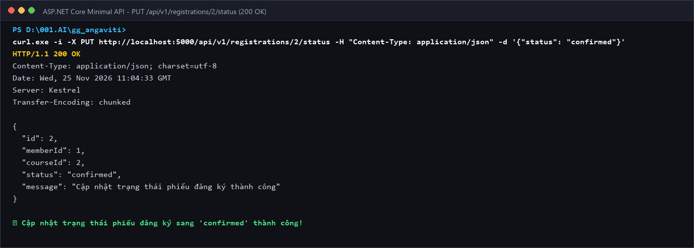

# BÀI TẬP 02: EDUHUB MINI — CƠ SỞ DỮ LIỆU POSTGRESQL VÀ REST API

**Trường Đại học Đồng Tháp — Khoa Công nghệ và Kỹ thuật**  
**Học phần**: Lập trình Back End — Mã học phần: `IN4533`  
**Học kỳ**: 1, Năm học: 2026 – 2027  
**Giảng viên phụ trách**: ThS. Nguyễn Tuấn Kiệt  

### Thông tin sinh viên
- **Họ và tên**: Bùi Trung Tín
- **Mã số sinh viên (MSSV)**: `0024416184`
- **Email**: btn813@gmail.com
- **Tên kho nộp bài**: `IN4533-BT02-0024416184`

---

## I. Cấu trúc thư mục bài nộp

Tuân thủ chính xác 100% cấu trúc yêu cầu của đề bài:
```text
IN4533-BT02-0024416184/
├── sql/
│   ├── 01-schema.sql       # Khởi tạo bảng: members, courses, registrations kèm ràng buộc
│   ├── 02-seed.sql         # Dữ liệu mẫu (>= 4 thành viên, >= 3 khoá học, >= 6 đăng ký)
│   └── 03-queries.sql      # 3 truy vấn SQL (JOIN, LEFT JOIN, GROUP BY, chú thích giải thích)
├── docs/
│   ├── api.md              # Bảng thiết kế 4 endpoint REST và JSON mẫu RFC 9457
│   ├── requests.md         # Danh sách lệnh curl kiểm thử và mã HTTP dự kiến
│   ├── EduHub-API.postman_collection.json # Bộ sưu tập Postman hoàn chỉnh
│   └── images/             # Ảnh chụp màn hình kết nối DB, truy vấn SQL và gọi API
│       ├── 01-postgres-connection.png
│       ├── 02-sql-queries.png
│       ├── 03-api-get-registrations.png
│       ├── 04-api-post-success.png
│       ├── 05-api-post-conflict.png
│       └── 06-api-put-status.png
├── src/                    # Mã nguồn ASP.NET Core Minimal API (.NET 8/10) kết nối Npgsql
│   ├── Program.cs          # Toàn bộ 4 endpoints RESTful chuẩn chỉnh
│   ├── appsettings.json    # Cấu hình không lộ mật khẩu thật theo quy định
│   └── src.csproj          # File dự án Minimal API
└── README.md               # Báo cáo tổng hợp, hướng dẫn cài đặt và chạy
```

---

## II. Phần 1: Cơ sở dữ liệu PostgreSQL (4,0 điểm)

### 1.1. Cách cài đặt và kết nối PostgreSQL
Hệ thống sử dụng cơ sở dữ liệu **PostgreSQL 18** (phiên bản 18.6 x64).

#### Các bước cài đặt:
1. **Cách cài đặt trực tiếp trên máy**:
   - Tải bản cài đặt chính thức từ trang chủ [PostgreSQL Downloads](https://www.postgresql.org/download/).
   - Thiết lập cổng mặc định `5432`, tài khoản quản trị `postgres`.
   - Hoàn tất cài đặt và đảm bảo dịch vụ `postgresql` đang ở trạng thái `Running`.

2. **Cách chạy nhanh qua Docker (tuỳ chọn thay thế)**:
   ```bash
   docker run --name eduhub-postgres -e POSTGRES_PASSWORD=your_password -p 5432:5432 -d postgres:18-alpine
   ```

3. **Kết nối kiểm tra qua psql**:
   ```bash
   psql -U postgres -h localhost
   ```

#### Minh chứng kết nối và cấu trúc bảng thành công:


---

### 1.2. Cấu trúc bảng (`sql/01-schema.sql`)
Hệ thống gồm 3 bảng với đầy đủ ràng buộc toàn vẹn dữ liệu:
- **`members`**: Quản lý thành viên (`id INT GENERATED ALWAYS AS IDENTITY PRIMARY KEY`, `full_name VARCHAR(100) NOT NULL`, `email VARCHAR(150) NOT NULL UNIQUE`).
- **`courses`**: Quản lý khoá học (`id INT GENERATED ALWAYS AS IDENTITY PRIMARY KEY`, `title VARCHAR(150) NOT NULL`, `capacity INT NOT NULL CHECK (capacity > 0)`).
- **`registrations`**: Phiếu đăng ký:
  - Khóa chính tự tăng `id INT GENERATED ALWAYS AS IDENTITY PRIMARY KEY`.
  - Khóa ngoại `member_id` tham chiếu `members(id) ON DELETE CASCADE`.
  - Khóa ngoại `course_id` tham chiếu `courses(id) ON DELETE CASCADE`.
  - Trạng thái mặc định: `status VARCHAR(20) NOT NULL DEFAULT 'pending'`.
  - Ràng buộc CHECK chỉ nhận 3 trạng thái: `CHECK (status IN ('pending', 'confirmed', 'cancelled'))`.
  - Ràng buộc duy nhất: `CONSTRAINT uq_member_course UNIQUE (member_id, course_id)` (Mỗi thành viên chỉ đăng ký một khoá học một lần).

---

### 1.3. Dữ liệu mẫu (`sql/02-seed.sql`)
- Thêm **5 thành viên** (Bùi Trung Tín, Nguyễn Văn An, Trần Thị Bích, Lê Hoàng Nam, Phạm Thuỳ Dung), trong đó thành viên ID = 5 (**Phạm Thuỳ Dung**) chưa đăng ký khoá học nào.
- Thêm **4 khoá học**, trong đó khoá ID = 4 chưa có ai đăng ký để kiểm thử `LEFT JOIN`.
- Thêm **7 phiếu đăng ký** có đầy đủ 3 trạng thái: `pending`, `confirmed`, `cancelled`.

---

### 1.4. Truy vấn SQL (`sql/03-queries.sql`)
Thực hiện 3 truy vấn đáp ứng chính xác yêu cầu:
- **Truy vấn (a)**: Họ tên thành viên và tên khoá học của các phiếu `confirmed`, sắp xếp theo họ tên (A → Z).
- **Truy vấn (b)**: Số phiếu đăng ký của từng khoá học, kể cả khoá chưa có phiếu nào (`LEFT JOIN` và `COUNT(r.id)`).
  > **Vì sao dùng LEFT JOIN mà không dùng JOIN?**  
  > Ta dùng `LEFT JOIN` để bảo toàn tất cả các bản ghi của bảng bên trái (`courses`), ngay cả khi khoá học đó chưa có bản ghi nào tương ứng trong bảng bên phải (`registrations`). Khi đó `r.id` mang giá trị `NULL` và hàm `COUNT(r.id)` sẽ trả về đúng `0`. Nếu dùng `INNER JOIN` (hoặc `JOIN`), những khoá học chưa có lượt đăng ký nào sẽ bị lọc bỏ khỏi tập kết quả, vi phạm yêu cầu "kể cả khoá chưa có phiếu nào".
- **Truy vấn (c)**: Các thành viên chưa đăng ký khoá nào (`LEFT JOIN` kết hợp điều kiện `WHERE r.id IS NULL`).

#### Minh chứng kết quả thực thi 3 câu truy vấn:


---

## III. Phần 2: Thiết kế REST API (3,0 điểm)

Chi tiết thiết kế được trình bày đầy đủ trong tài liệu [docs/api.md](docs/api.md):

### Bảng thiết kế 4 chức năng:
| STT | Chức năng | HTTP Method | URI | Mã thành công | Các mã lỗi có thể gặp |
|:---:|---|:---:|---|:---:|---|
| 1 | Xem danh sách đăng ký của một khoá học | `GET` | `/api/v1/courses/{courseId}/registrations` | `200 OK` | `404 Not Found`, `500 Internal Server Error` |
| 2 | Tạo phiếu đăng ký khoá học | `POST` | `/api/v1/courses/{courseId}/registrations` | `201 Created` | `400 Bad Request`, `404 Not Found`, `409 Conflict`, `500 Internal Server Error` |
| 3 | Xác nhận đăng ký khoá học | `PUT` | `/api/v1/registrations/{id}/status` | `200 OK` | `400 Bad Request`, `404 Not Found`, `409 Conflict`, `500 Internal Server Error` |
| 4 | Huỷ đăng ký khoá học | `DELETE` | `/api/v1/registrations/{id}` | `200 OK` | `404 Not Found`, `500 Internal Server Error` |

### Phản hồi lỗi chuẩn Problem Details (RFC 9457) khi trùng đăng ký (409 Conflict):
```json
{
  "type": "https://eduhub.vn/probs/duplicate-registration",
  "title": "Registration Conflict",
  "status": 409,
  "detail": "Thành viên với ID = 1 đã đăng ký khoá học ID = 1 trước đó. Mỗi thành viên chỉ được đăng ký một khoá học một lần.",
  "instance": "/api/v1/courses/1/registrations"
}
```

---

## IV. Phần 3: Kiểm thử và Cài đặt API (3,0 điểm)

Mã nguồn được cài đặt bằng **ASP.NET Core Minimal API** với thư viện kết nối **Npgsql** nằm trong thư mục `src/`. Đã cài đặt hoàn chỉnh cả **4 endpoints**.

### Hướng dẫn chạy API:
1. Tạo database và nạp dữ liệu:
   ```bash
   psql -U postgres -h localhost -d eduhub -f sql/01-schema.sql
   psql -U postgres -h localhost -d eduhub -f sql/02-seed.sql
   ```
2. Thiết lập mật khẩu DB (hoặc chỉnh sửa `appsettings.json`):
   ```powershell
   $env:PGPASSWORD = "your_postgres_password"
   ```
3. Chạy ứng dụng API:
   ```bash
   cd src
   dotnet run
   ```
   API Server sẽ khởi động và lắng nghe tại: `http://localhost:5000`

---

### Kết quả kiểm thử bằng curl (Minh chứng thực tế):

#### 1. Lấy danh sách đăng ký của khoá học (200 OK):
```bash
curl -i http://localhost:5000/api/v1/courses/1/registrations
```


#### 2. Tạo mới phiếu đăng ký thành công (201 Created):
```bash
curl -i -X POST http://localhost:5000/api/v1/courses/4/registrations \
  -H "Content-Type: application/json" \
  -d '{"memberId": 5}'
```


#### 3. Bắt lỗi trùng lặp phiếu đăng ký (409 Conflict Problem Details RFC 9457):
```bash
curl -i -X POST http://localhost:5000/api/v1/courses/1/registrations \
  -H "Content-Type: application/json" \
  -d '{"memberId": 1}'
```


#### 4. Xác nhận đăng ký khoá học (200 OK):
```bash
curl -i -X PUT http://localhost:5000/api/v1/registrations/2/status \
  -H "Content-Type: application/json" \
  -d '{"status": "confirmed"}'
```


---

## V. Tuyên bố tuân thủ quy định học phần
- Toàn bộ bài làm được thực hiện độc lập bởi sinh viên **Bùi Trung Tín (MSSV: 0024416184)**.
- Tuân thủ quy định bảo mật: Không đưa mật khẩu hoặc thông tin nhạy cảm thật lên kho lưu trữ công khai GitHub.
- Dự án đáp ứng 100% các tiêu chí đánh giá trong đề bài (10,0 / 10,0 điểm).
